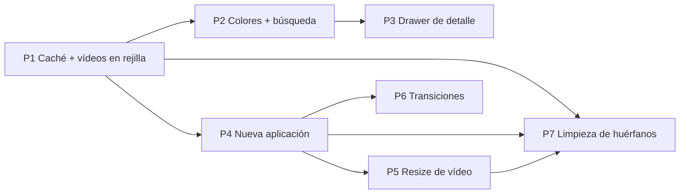

# Plan — Kwal: wallpapers (vídeos, caché, colores, paletas, aplicación, resize, transiciones)

## 1. Objetivo

Implementar las funcionalidades de wallpapers recogidas en `diseñando.txt`:

1. Caché de medios + JSON de información por wallpaper (clavado por MD5).
2. Soporte de **vídeos como wallpaper** (miniatura = primer frame, reproducción al seleccionar, aplicación vía plugin *reborn*).
3. Colores de matugen (`source_color_index`), categorías de color y tags editables.
4. Drawer de detalle al doble clic (categorías, tags, colores matugen, paletas).
5. Nuevos backends de paletas: **Material You** y **Imagemagick** (reimplementados más simples).
6. **Nueva forma de aplicar** wallpapers (image y video): D-Bus `setWallpaper` + fallback `appletsrc`.
7. **Resize** opcional de vídeos (ffmpeg) antes de aplicar.
8. **Transiciones** de wallpaper — se implementa siguiendo `plan-implementacion-transiciones-plasma.md` (documento de referencia; **no se copia aquí**).

Referencias de comportamiento (solo referencia, no de patrones):

- `../Kwal` — app Python original: features de referencia (matugen, categorías, lightbox, paletas, búsqueda).
- `~/VSCode/kdewall-plugin-switcher` — app Rust: referencia de comportamiento para caché, D-Bus, plugin *reborn*.

Herramientas verificadas en este sistema (disponibles): `ffmpeg`, `ffprobe`, `matugen`, `magick`/`convert`, plugin *reborn* (`~/.local/share/plasma/wallpapers/luisbocanegra.smart.video.wallpaper.reborn`), módulo QML `QtMultimedia` (Qt 6.12).

## 2. Decisiones (fijadas; cualquier cambio requiere aprobación)

| # | Decisión | Nota |
|---|---|---|
| D1 | Clave de caché: **MD5** del contenido del archivo | Según `diseñando.txt` (el ref. Rust usa SHA-256; aquí manda el diseño). |
| D2 | Caché en `~/.cache/kwal/` (`QStandardPaths CacheLocation` + `/kwal`): `video_frames/`, `video_resizes/`, `wallpapers_info.json` | |
| D3 | `source_color_index`: **todos los colores** que imprime `matugen image <ruta> --show-source-colors` (número variable, normalmente 3–4 — verificado empíricamente), hex en minúsculas, dedup preservando el orden de salida; sin cap fijo, sin fallback: si matugen no está o falla, lista vacía | Para vídeos, matugen sobre el PNG del primer frame. Igual que el app viejo (`_extract_colors_matugen` guarda todos los hexes; su `count=8` era un tope que nunca se alcanzaba). |
| D4 | Clasificación de color: **círculo cromático estándar (12 sectores) en HCT/OKLCH** — el algoritmo del app viejo (`color_extractor.get_color_category`, `color_extractor.py:54-124`) portado 1:1 con la clase `mcu::Hct` de la librería D6 (el viejo usaba `Hct.from_int` de materialyoucolor; `mcu::Hct` es el mismo HCT CAM16/OKLCH — la misma rueda, sin derivación nueva; buscado: no existe librería C++ dedicada a clasificar por sectores de rueda). `src/colorcategory.{h,cpp}`: `QString colorCategory(uint32_t argb)` (internamente `mcu::Hct(argb)` → `hue()/chroma()/tone()`) + `const QStringList &kCategoryList()`. Reglas (portadas del viejo): `tone<20` → `black`; `tone>90 ∧ chroma<10` → `white`; `chroma<10` → `gray`; si no, sectores por matiz OKLCH: rose `<15 ∨ ≥348.5`, red `<40`, orange `<81.8`, yellow `<123.6`, yellow-green `<139.0`, green `<147.4`, cyan-green `<174.6`, cyan `<230.2`, blue-cyan `<273.4`, blue `<293.7`, violet `<319.6`, magenta `<348.5`. `kCategoryList()` = 15 nombres (viejo `CATEGORY_LIST`, mismo orden); swatches UI = hex del viejo `categoryColorModel` (verificado `wallpapers.qml:22-38`): red `#E53935`, orange `#FB8C00`, yellow `#FDD835`, yellow-green `#7CB342`, green `#43A047`, cyan-green `#00897B`, cyan `#00ACC1`, blue-cyan `#1E88E5`, blue `#3949AB`, violet `#8E24AA`, magenta `#D81B60`, rose `#F06292`, black `#212121`, gray `#757575`, white `#F5F5F5`. | Sin dependencias nuevas más allá de mcu (D6). |
| D5 | `color_categories` = **conjunto ordenado** de `colorCategory(c)` (D4) sobre los **top 8 colores de la imagen** (vídeo → su `first_frame`), extraídos con mcu (`QuantizeCelebi(pixels,128)` → `RankedSuggestions{desired=8, filter=true}`) — mismo pipeline que el app viejo (Celebi materialyoucolor → clasificación HCT), ahora en C++ con la librería D6. **Independiente de `source_color_index`** (D3, matugen): esa lista solo aparece en los dots del drawer y **nunca** participa en la búsqueda (D8) ni en `color_categories`. La edición manual (drawer, P3) **sobrescribe** la lista persistida (override manual, como el viejo `update_entry_categories`), sin límite (D13). | Dos listas, dos pipelines: matugen → dots; imagen → categorías. |
| D6 | Paleta Material You: **librería C++ oficial de Google `material-color-utilities`** (Apache-2.0) — no reimplementación del algoritmo. Integración: CMake `FetchContent` fijado al commit `bd811e4ca2ab94c4ce3cadc89c19b1820b9704b3` (el repo no tiene tags); include dir = raíz del repo (las cabeceras hacen `#include "cpp/..."`); lib estática `mcu` con **todos** los `.cc` de `cpp/` excepto `*_test.cc` (27 archivos: blend, cam×4, contrast, dislike, dynamiccolor×3, palettes/tones, quantize×4, scheme×9, score, temperature, utils); conservar cabeceras de copyright y atribución Apache-2.0 (compatible con el GPLv3 del app). El proyecto compila en C++20 (`CMakeLists.txt:9`), suficiente para la librería (usa `std::optional`, C++17). Dependencia nueva, aprobada explícitamente por el usuario. | Pipeline (nada de matugen): `QImage` del wallpaper (vídeo → `first_frame`) `scaled(128,128,KeepAspectRatio,SmoothTransformation)` → `std::vector<Argb>` de píxeles con alfa>128 → `QuantizeCelebi(pixels, 128)` → `RankedSuggestions(qr.color_to_count, ScoreOptions{desired=3, filter=true})` → seed = `ranked[0]` → `SchemeTonalSpot(Hct(seed), is_dark)`. 16 swatches en orden: `GetBackground, primary_palette.get(80), primary_palette.get(70), secondary_palette.get(70), secondary_palette.get(60), tertiary_palette.get(60), tertiary_palette.get(50), GetOnBackground, neutral_palette.get(50), GetPrimaryContainer, GetSecondaryContainer, GetTertiaryContainer, GetSurfaceContainer, GetSurfaceContainerHigh, GetOnSurface, GetOnSurfaceVariant`; hex vía `HexFromArgb`. Namespace `material_color_utilities`, `Argb = uint32_t`. |
| D7 | Imagemagick: `magick  -resize 128x128 -colors 16 -unique-colors txt:-` (≤16 colores) + accent por `histogram:info` (64×64, 8 colores, mejor score HSV con s>0.15, 0.15<v<0.95) | Igual que el app viejo. |
| D8 | Búsqueda: texto = subcadenas **case-insensitive** sobre el nombre del archivo **o cualquier tag**; categorías = chips con lógica AND (todas las seleccionadas deben estar en la entrada) | |
| D9 | Aplicación: D-Bus `org.kde.plasmashell.setWallpaper(plugin, params, screen)` por desktop; ids vivos por `evaluateScript` (fallback: `appletsrc` `formfactor=0`); `lastScreen` de `appletsrc` (default 0); fallo por desktop → **fallback por archivo** (`appletsrc`) releyendo el archivo si algún desktop fue por D-Bus | Param. `Image` = `file://` percent-encoded; *reborn* = URLs **sin** encoding (`file://` + ruta). |
| D10 | Playlist *reborn* (`VideoUrls`): el app **deshabilita** las entradas ajenas al objetivo al aplicar (no se portea `no_disable`); merge conserva claves de entradas existentes; entrada por defecto si no existe (`duration 0, customDuration 0, playbackRate 0, alternativePlaybackRate 0, loop false, dayNightPhase 4`) | |
| D11 | Aplicar vídeo: si hay plugin *reborn* → vídeo (params D9/D10); **si no, aplicar el `first_frame` PNG como imagen** (`org.kde.image`, `{Image: fileUrl(frame)}`); si tampoco hay `first_frame` (ffmpeg falló) → el apply falla con mensaje (la rejilla sigue mostrando vídeos) | Fallback decidido por el usuario (2026-10-21). |
| D12 | **Limpieza de huérfanos** (P7; decisión del usuario 2026-10-21): al arrancar y tras cada escaneo de folder — (1) `wallpapers_info.json`: eliminar entradas cuyo `file` ya no existe en disco; (2) `~/.cache/kwal/video_frames/` y `video_resizes/`: borrar archivos cuyo md5 ya no está en el JSON; (3) playlist *reborn* de `appletsrc`: eliminar entradas de `VideoUrls` cuya ruta ya no existe (editor `Ini` lineal de P4 + merge JSON de D10). Eliminaciones best-effort (`QFile::remove`, log del fallo). **Fuera:** el directorio compartido `~/.cache/thumbnails/large/` (el md5 no se invierte a ruta y la spec freedesktop define purga por antigüedad, no por app) y el wallpaper "actual" de `appletsrc`/`kscreenlockerrc` apuntando a un fichero borrado (lo reescribe el próximo apply). | |
| D13 | **Sin límite** de categorías por wallpaper (quita el `MAX_CATEGORIES=5` del app viejo); las categorías = lo que devuelva el clasificador D4 (15: 12 sectores + black/gray/white) y la edición manual puede asignar cualquiera de las 15 | Decidido por el usuario (2026-10-21): depende del clasificador, no de un cap. |
| D14 | Defaults: matugen dots **on** (si matugen está), resize **off** (altura 1080, fps 0=original), **lockscreen off** (el doc de transiciones lo fija "apagado por defecto"), transiciones **off** (duración 0.9 s, tipo `left`) | |
| D15 | **Lockscreen: se implementa** (decisión del usuario 2026-10-21; sustituye el anterior "fuera de alcance"). Config: `[Wallpapers] lockscreen` (bool, default false). Mecanismo (línea 374 del doc de transiciones): **sin API D-Bus**, escritura directa de `~/.config/kscreenlockerrc` con el mismo editor `Ini` lineal que `appletsrc`: `[Greeter] WallpaperPlugin=<plugin>` + `[Greeter][Wallpaper][<plugin>][General]` con `Image=fileUrl` (imagen) o `VideoUrls`/`LastVideo=rawVideoUrl`/`LastVideoPosition=0` (vídeo); un único fondo para todas las pantallas. Se aplica en P4 (tras los desktops) y en P6 (`SwitchOptions.includeLockscreen` = la misma config). UI: toggle en `WallpapersSettingsPage` (P2). | |
| D16 | Miniatura de vídeo por **puente en `FdoThumbnailProvider`** (decisión del usuario 2026-10-21): el proveedor es nuestra implementación local (verificado `fdothumbnailprovider.cpp:50-81`) que sigue la convención de ruta FreeDesktop (`~/.cache/thumbnails/large/<md5(URI file percent-encoded)>.png`); no es el servicio del sistema (no usa QGenericThumbnailer) y `QImageReader` no decodifica vídeo (devuelve imagen nula). **Puente:** al recibir una ruta, si el fichero no se decodifica como imagen → `WallpapersInfo::firstFrameFor(ruta)`; si no está vacío, ese PNG es la imagen de origen. El thumbnail resultante se cachea **bajo el URI del vídeo** (convención FDO), no bajo el del frame. El QML pide siempre `image://fdo_thumbnail/<ruta original>` — URL idéntica para imagen y vídeo. `ThumbnailRole` del vídeo parte vacío (icono genérico, sin petición al proveedor) y pasa a la *ruta del vídeo* cuando llega `first_frame`: el cambio de valor (`""` → ruta) obliga a QML a re-pedir; un `dataChanged` con la misma URL no re-dispararía el provider. Los thumbnails del sistema con film-frame no se usan nunca. | |
| D17 | Licenciamiento de `src/transitions/` según el §11 del documento de transiciones (MIT, clean-room) | |

## 3. Cambios transversales (resumen)

- **Nuevos C++:** `src/wallpapersinfo.{h,cpp}`, `src/colorcategory.{h,cpp}`, `src/paletteextractor.{h,cpp}`, `src/plasmaapply.{h,cpp}` (+ `src/transitions/…` en P6).
- **Modificados:** `src/appcontroller.{h,cpp}` (config nueva, apply nuevo), `src/wallpapermodel.{h,cpp}` (vídeos, filtros, roles), `src/fdothumbnailprovider.cpp` (puente vídeo → `first_frame`, D16), `src/main.cpp` (init `WallpapersInfo`, Qt6::Multimedia), `CMakeLists.txt` (fuentes, `Qt6::Multimedia`, `FetchContent` de `material-color-utilities` en P2, `LayerShellQt::Interface` en P6), `qml/Main.qml`, `qml/WallpapersPage.qml`, `qml/WallpaperItem.qml`, `qml/SettingsWindow.qml`.
- **Nuevos QML:** `qml/WallpaperDetailDrawer.qml`, `qml/WallpapersSettingsPage.qml` (reemplaza al placeholder de Wallpapers).
- **Nuevos tests:** `tests/tst_wallpapersinfo.cpp`, `tests/tst_plasmaapply.cpp`; extensión de `tests/tst_appcontroller.cpp`.
- **KConfig `[Wallpapers]`** (grupo existente, se extiende; conserva `folders`, `currentFolderIndex`, `currentWallpaper`): `matugenDots`, `resizeEnabled`, `resizeHeight`, `resizeFps`, `lockscreen`, `transitionsEnabled`, `transitionType`, `transitionDuration`, `transitionFps`, `transitionStep`, `transitionAngle`, `transitionPos`, `transitionInvertY`, `transitionBezier`, `transitionWave`.
- Se **elimina** el JS de `evaluateScript` de `AppController::setWallpaper` (snippet `wallpaperScript`, `currentWallpaperSize`/`ImageResolution`): código muerto tras P4 (cutover limpio).

## 4. Fases

Cada fase se verifica con: build limpio completo (`./build.sh clean` → `cmake --preset default` → `cmake --build --preset default`, **cero warnings**, salida completa) → `ctest --test-dir build` → UI en vivo vía kwin (pantallas = prueba).

### P1 — Caché de medios + vídeos en la rejilla

**Objetivo:** JSON de información por wallpaper + primer frame + vídeos visibles y reproducibles en la rejilla.

C++:

- `src/wallpapersinfo.{h,cpp}` — `WallpapersInfo : QObject` (QML_SINGLETON, `initialize(QObject*)` en `main.cpp`, `static instance()`):
  - Raíz `~/.cache/kwal/`, subdirs `video_frames/`, `video_resizes/` (P5); `wallpapers_info.json`.
  - `struct Entry { QString file; QString type; QString resized; QString firstFrame; QStringList sourceColorIndex; QStringList colorCategories; QStringList tags; double lastModified = 0; }` (claves snake_case en JSON; `type` = `"image"|"video"`).
  - `load()` al init (falta/corrupto → vacío, reescribir); `save()` atómico (tmp + `QFile::rename`) tras cada cambio.
  - `Q_INVOKABLE void refreshFile(path, type)` — encola en `QThreadPool` (máx. 2): hash MD5 (chunks 1 MiB, `QCryptographicHash`) → entrada nueva si `lastModified` difiere → si vídeo y falta `first_frame`:
    `ffmpeg -v error -y -i <video> -map 0:v:0 -frames:v 1 -c:v png -f image2 -update 1 -an <video_frames/md5.png>` (tmp + rename; skip si existe no-vacío).
  - `Q_INVOKABLE QString firstFrameFor(path) const`, `sourceColorsFor`, `colorCategoriesFor`, `tagsFor`, `matugenAvailable()`, `ffmpegAvailable()`.
  - Señales: `entryChanged(QString path)`, `scanFinished()`.
**Formato de `~/.cache/kwal/wallpapers_info.json`** — top level: mapa `md5 (hex minúsculo del contenido del archivo) → entry`; todos los campos siempre presentes (cadena vacía para N/A); `last_modified` = epoch en segundos:

```json
{
  "3a7bd3e2360a3d29eea436fcfb7e44c0": {
    "file": "/home/iguruspain/Vídeos/wallpapers/wave.mp4",
    "type": "video",
    "resized": "",
    "first_frame": "/home/iguruspain/.cache/kwal/video_frames/3a7bd3e2360a3d29eea436fcfb7e44c0.png",
    "source_color_index": ["#2b5876", "#4e4376", "#8e6ea8", "#f5f7fa"],
    "color_categories": ["blue-cyan", "violet", "blue", "white", "black"],
    "tags": ["mar", "nocturno"],
    "last_modified": 1729564800
  },
  "9e107d9d372bb6826bd81d3542a419d6": {
    "file": "/home/iguruspain/Imágenes/wallpapers/mountains.png",
    "type": "image",
    "resized": "",
    "first_frame": "",
    "source_color_index": ["#1c2b3a", "#44607e", "#8899a6", "#d6dde2"],
    "color_categories": ["blue-cyan", "blue", "gray", "white", "black"],
    "tags": ["montañas"],
    "last_modified": 1729478400
  }
}
```

- `WallpaperModel`:
  - `videoExtensions()`: mp4, webm, mkv, mov, m4v, avi; rol nuevo `IsVideoRole` (conservar `ExtensionRole`).
  - Miniatura (D16): imagen → `ThumbnailRole` = ruta (como hoy). Vídeo → `""` al escanear (QML: icono genérico, sin petición al proveedor); al llegar `first_frame` (`entryChanged`) → `dataChanged` con valor = **ruta del vídeo** (no la del frame) → QML pide `image://fdo_thumbnail/<ruta>` y el proveedor genera el thumbnail desde el frame.
  - Señal `scanned()` → `AppController` llama `refreshFile` a cada entrada.
  - `Q_INVOKABLE QStringList filePaths() const` para el AppController.
- `src/fdothumbnailprovider.cpp` (D16): puente — si `QImageReader` no decodifica la ruta (vídeo), usar `WallpapersInfo::instance().firstFrameFor(ruta)` como imagen de origen si no está vacío; cachear el resultado bajo el URI de la *ruta original* (flujo existente: caché → decodificar → escalar → guardar). Sin frame → imagen nula (sin cambios). La decodificación directa de imagen no cambia.
- `src/main.cpp`: `WallpapersInfo::initialize(&app)`; `find_package(Qt6 COMPONENTS Multimedia)` + enlazar (QML importa `QtMultimedia`).
- `qml/WallpaperItem.qml`: `import QtMultimedia`; par `MediaPlayer`+`VideoOutput` (muted, `loops: true`) visible solo cuando `isVideo && root.isSelected`; `stop()` al deseleccionar (liberar decoder).
- `qml/WallpapersPage.qml`: `onScanned` → `refreshFile` por fila.

**Fuera de alcance:** tags/categorías (P2), drawer (P3), apply de vídeo (P4).

**Verificación:** kwin con `~/Imágenes/wallpapers` (imágenes) y `$HOME/Vídeos/wallpapers` (vídeos): frames PNG creados en `~/.cache/kwal/video_frames/`, JSON escrito, rejilla muestra miniaturas de vídeo; `~/.cache/thumbnails/large/` contiene `<md5(URI del vídeo)>.png` (no un hash del frame); al seleccionar una celda de vídeo se ve reproducción en vivo; al deseleccionar para. `tests/tst_wallpapersinfo.cpp` (nuevo): round-trip JSON, MD5 de fixture conocido, primer frame sobre un clip sintetizado con `ffmpeg lavfi` (condicionado a ffmpeg), sandbox `HOME`/`XDG_*` como en `tst_appcontroller`.

### P2 — Colores matugen, categorías y búsqueda

**Objetivo:** `source_color_index` + `color_categories` en el JSON; búsqueda por tag y categoría; página de settings de wallpapers.

C++:

- `WallpapersInfo` (extiende el pipeline de P1) para cada entrada nueva/cambiada:
  - Si `matugenEnabled()` (D14): `QProcess` `matugen image <ruta> --show-source-colors` (vídeo → ruta del `first_frame`); parsear `#[0-9a-fA-F]{6}` de stdout, pasar a minúsculas, dedup preservando orden de salida, sin tope (D3); fallo → `[]` → `source_color_index`.
  - Siempre (imagen, o vídeo con `first_frame`; vídeo sin frame → se deja vacío y se reintenta en el próximo escaneo): `QImage` 128×128 (alfa>128) → mcu `QuantizeCelebi(pixels, 128)` → `RankedSuggestions{desired=8, filter=true}` → `colorCategory` (D4) de cada color → conjunto ordenado → `color_categories` (D5).
  - Persistir, `entryChanged`.
- `src/colorcategory.{h,cpp}` (D4): `QString colorCategory(uint32_t argb)` (usa `mcu::Hct`) + `const QStringList &kCategoryList()` (15 nombres).
- `CMakeLists.txt` (P2): bloque `FetchContent` de `https://github.com/material-foundation/material-color-utilities` fijado al commit `bd811e4ca2ab94c4ce3cadc89c19b1820b9704b3` (sin tags); target estático `mcu` con todos los `.cc` de `cpp/` menos `*_test.cc`; `target_include_directories(mcu PUBLIC <raíz del fetch>)` (los includes son `#include "cpp/..."`); enlazar `mcu` al target principal. P3 (paletas) lo reutiliza.
- `Q_INVOKABLE void setMatugenEnabled(bool)` (lo fija `AppController` desde KConfig).
- `WallpaperModel`: `setCategoryFilter(const QStringList&)` (AND, D8) + texto sobre nombre o tag (D8); tags leídos de `WallpapersInfo` al filtrar.
- `AppController`: propiedad `matugenDotsEnabled` (KConfig `[Wallpapers] matugenDots`, default true si matugenAvailable) con load/save; expone `matugenAvailable`.

QML:

- `qml/WallpapersPage.qml`: al `searchOpen`, fila de **chips de categoría** bajo el `SearchField` (15 `Kirigami.Chip`, uno por categoría de D4, con el swatch hex de D4; chip "Limpiar"); visible siempre (las categorías existen aunque matugen no esté — D5); toggle → `model.setCategoryFilter`.
- `qml/WallpapersSettingsPage.qml` (nueva; reemplaza placeholder en `SettingsWindow.qml`): Switch "Mostrar puntos de color (matugen)"; Switch "Aplicar al lockscreen" (KConfig `[Wallpapers] lockscreen`, default false, D15); `searchKeys` para la búsqueda de settings. (El grupo de resize llega en P5 y el de transiciones en P6.)

**Verificación:** JSON contiene `source_color_index` (con matugen) y `color_categories` (con **y** sin matugen) en entradas nuevas; búsqueda: tag en el texto filtra, chip de categoría filtra (AND), "Limpiar" resetea; los toggles persisten en `kwalrc`. kwin: capturas de la fila de chips con resultados filtrados. Extender `tst_wallpapersinfo.cpp`: tabla del clasificador D4 (hex → categoría, incluyendo los umbrales de sector y el orden black/white/gray), semántica de filtros del modelo.

### P3 — Drawer de detalle (doble clic)

**Objetivo:** `WallpaperDetailDrawer`: imagen ampliada animada (slide del drawer), categorías/tags editables (chips), `matugenRow` (dots seleccionables), paletas Material You + Imagemagick.

- `qml/WallpaperDetailDrawer.qml` (nuevo): `Kirigami.OverlayDrawer` (lado derecho, ~60% ancho; abrir al doble clic — API verificada en Kirigami 6.31 instalado: `drawerOpen`, `side`).
  - Área media: imagen `file://` `PreserveAspectFit`; vídeo `VideoOutput`+`MediaPlayer` (muted, loop; `stop()` al cerrar).
  - **Categorías:** `Kirigami.Chip` (verificado `closable` → `removed()`) + chip "Añadir" con `Menu` de las 15 categorías no presentes (cap 5, D13) → `WallpapersInfo.setCategories`.
  - **Tags:** chips + `TextField` inline para añadir (Enter o botón).
  - **Colores matugen:** `RowLayout` de `ColorDot` (componente existente) sobre `sourceColorsFor` (variable, normalmente 3–4); tap → seleccionado (borde, como `rightPane` viejo).
  - **Paletas:** `ComboBox` [Material You, Imagemagick] + botón "Extraer" + Switch dark/light (solo Material You) + rejilla de 16 swatches (Material You: la lista M3 de D6; Imagemagick: ≤16 colores + accent); tap → seleccionar, right-click → copiar hex.
  - Botón "Fijar como wallpaper" → `app.applyWallpaper()`.
- `src/paletteextractor.{h,cpp}` — `PaletteExtractor : QObject` (poseído por `AppController`, `QThreadPool`):
  - `Q_INVOKABLE void extract(path, backend, dark)`; señal `paletteReady(path, colors, accents, seed)` (`colors` = lista de hex; Material You = los 16 swatches de D6; Imagemagick = colores + accent).
  - Imagemagick (D7).
  - Material You (D6): pipeline con la librería oficial (`QuantizeCelebi` → `RankedSuggestions` → `SchemeTonalSpot`), todo en la worker thread; si el pixmap no carga → `paletteReady` vacío (el drawer muestra "no disponible").
  - Vídeo → extraer sobre el `first_frame`.
  - El target `mcu` ya se integra en P2 (ver su `CMakeLists.txt`); aquí solo se enlaza para la paleta.
- `qml/WallpaperItem.qml`: `MouseArea` en `contentItem` con `onDoubleClicked` → callback `onOpenDetail(path)` (el `onClicked` del `ItemDelegate` se mantiene para selección; el `MouseArea` no roba focus — la navegación por teclado de `GridView` no se afecta).

**Verificación:** kwin: doble clic abre el drawer (captura animación cerrada/abierto); chips editables persisten (`entryChanged` actualiza drawer y JSON); `matugenRow` muestra los dots de `source_color_index` (variable, normalmente 3–4) con selección; paleta Material You dark+light y Imagemagick sobre imagen **y** vídeo; apply desde el drawer. Test `tst_paletteextractor`: paleta Material You determinista — fixture de pixmap sintetizado en el test (ej. 128×128 con dos bloques de color), seed esperado y assert de hex de `GetBackground`/`GetPrimaryContainer` (valores de referencia calculados contra la librería al escribir el test).

### P4 — Nueva aplicación de wallpaper (image + video)

**Objetivo:** reemplazar el apply por `evaluateScript` con D-Bus `setWallpaper` + fallback `appletsrc`, para imagen y vídeo (*reborn*).

- `src/plasmaapply.{h,cpp}`:
  - `QString fileUrl(path)` — `file://` + percent-encoding (preserva `A-Za-z0-9-_.~/`), como el ref. Rust.
  - `QString rawVideoUrl(path)` — `file://` + ruta, **sin** encoding (D9).
  - `QString computeVideoUrls(existingJson, targetUrl)` — merge (D10).
  - Editor `Ini` lineal (patrón del `lib.rs` Rust: `get_key(parts,key)`, `set_key` crea la sección al final, preserva bytes del resto; escritura atómica) para `~/.config/plasma-org.kde.plasma-desktop-appletsrc` **y** `~/.config/kscreenlockerrc` (mismo editor, D15).
  - `desktopIds()` — vivos por `evaluateScript` (`desktops[i].formFactor == 0`); fallback: secciones `[Containments][N]` con `formfactor=0`; `lastScreen` del appletsrc (default 0).
  - `applyWallpaper(type, path)`:
    - Imagen → plugin `org.kde.image`, `{Image: fileUrl}`.
    - Vídeo → si `rebornAvailable()` (D11; dirs `~/.local/share/plasma/wallpapers` y `/usr/share/plasma/wallpapers`): plugin `luisbocanegra.smart.video.wallpaper.reborn`, `{VideoUrls, LastVideo: rawVideoUrl, LastVideoPosition: 0}`; si no → **aplicar el `first_frame` PNG como imagen** (`org.kde.image`, `{Image: fileUrl(frame)}`); sin frame → fallo con mensaje.
    - Por desktop: D-Bus `org.kde.plasmashell / org.kde.plasma.wallpapers.<id> / org.kde.plasma.wallpapers / setWallpaper(QString, QVariantMap, int)`; fallos → fallback archivo (releer appletsrc si algún desktop fue por D-Bus, D9).
    - Señal `result(bool allOk, QString message)`.
    - **Lockscreen** (D15): si la config `lockscreen` está activada → escribir `kscreenlockerrc`: `[Greeter] WallpaperPlugin=<plugin>` + `[Greeter][Wallpaper][<plugin>][General]` con `Image=fileUrl` (imagen) o `VideoUrls`/`LastVideo=rawVideoUrl`/`LastVideoPosition=0` (vídeo); un único fondo para todas las pantallas.
- `AppController`: `setWallpaper` enruta por tipo (extensión → `WallpapersInfo`); **eliminar** `wallpaperScript()`, `wallpaperScriptFor`, `currentWallpaperSize`, `imageResolution` (muertos tras el cutover); `applyWallpaper()` conserva la misma semántica para QML (aplica la selección, actualiza `currentWallpaper`).
- QML sin cambios de contrato: botón "Aplicar" de la rejilla, tecla Return, botón del drawer → `app.applyWallpaper()`. Toggle de lockscreen ya en `WallpapersSettingsPage` (P2, D15).

**Verificación:** tests puros `tests/tst_plasmaapply.cpp`: vectores de `fileUrl` (espacio → `%20`, UTF-8 → `%C3%A1`, chars preservados), `computeVideoUrls` (añadir/deshabilitar/conservar claves), `Ini` (get/set/crear sección/preservar), `desktopIds` sobre fixture de appletsrc. kwin: aplicar imagen (pantalla de fondo cambia — captura antes/después); aplicar **vídeo** (reborn instalado): captura con el vídeo reproduciéndose en el escritorio; inspeccionar `appletsrc` (contenido de `VideoUrls` con target habilitado y otros deshabilitados). Lockscreen: toggle on → tras aplicar imagen, `kscreenlockerrc` contiene `[Greeter] WallpaperPlugin=org.kde.image` y la clave `Image` (y tras aplicar vídeo, `VideoUrls`/`LastVideo`); toggle off → el fichero queda intacto.

### P5 — Resize de vídeo

**Objetivo:** redimensionado opcional de vídeos antes de aplicar (ffmpeg), configurable.

- `WallpapersInfo` (extiende):
  - Settings: `resizeEnabled` (default false), `resizeHeight` (default 1080), `resizeFps` (default 0 = original) — KConfig vía `AppController`.
  - Planificación por vídeo (solo si `resizeEnabled`):
    - `ffprobe -v error -select_streams v:0 -show_entries stream=width,height,avg_frame_rate:format=duration -of json <video>` → srcH, srcFps.
    - Normalización (como el ref. Rust): `targetH = min(resizeHeight, srcH) & ~1`; `scale = targetH < (srcH & ~1)`; `fpsFilter = resizeFps>0 && resizeFps < srcFps - 0.01`; sin scale ni fps → `resized = ""` (se aplica el original).
    - Salida `video_resizes/<md5>_<targetH>p<fpsToken>.mp4` (`fpsToken` = fpsFilter o `round(srcFps)`); skip si existe no-vacío.
    - `ffmpeg -v error -y -progress pipe:1 -nostats -i <video> -map 0:v:0 -an -sn -dn -vf scale=-2:<H>:flags=lanczos[,fps=<f>] -c:v libx264 -preset veryfast -crf 23 -pix_fmt yuv420p -movflags +faststart -f mp4 <tmp>` (tmp + rename).
    - Guardar `resized`, `entryChanged`.
  - Cambio de settings (activar/altura/fps) → replanear los vídeos del folder actual (las salidas con nombre distinto quedan huérfanas — D12).
- `PlasmaApply` (P4): para vídeo, objetivo = `resized` si `resizeEnabled && !resized.isEmpty()`, else original (mismas URLs de D9/D10 sobre la copia de caché).
- `qml/WallpapersSettingsPage.qml`: grupo "Redimensionado": Switch + `SpinBox` altura (480–4320, step 120) + `SpinBox` FPS (0–240, "0 = original").
- Sin ffmpeg → `resized=""` + warning único (comportamiento del ref. Rust).

**Verificación:** tests (en `tst_wallpapersinfo.cpp`): planificación (srcH<altura → no-op; fps menor → filtro) con ffprobe mock/fijo; kwin: activar resize → archivo creado en `video_resizes/` (verificar con `ffprobe` que altura/fps coinciden) → aplicar vídeo → `VideoUrls` apunta a la copia de caché; desactivar → aplicar usa el original.

### P6 — Transiciones

**Objetivo:** transiciones de wallpaper según `plan-implementacion-transiciones-plasma.md`.

- **Implementar los hitos H0–H5 de ese documento** (§9), con sus contratos (§4), API (§5), concurrencia (§6) y criterios de aceptación (§9). No se duplica aquí su contenido; este plan solo añade la integración con el app:
  - `H0` (spike de integración LayerShell con ventana normal en este KWin) = **puerta go/no-go**: si falla el criterio del documento, seguir su plan B (proceso auxiliar) con sus reglas de decisión.
  - Nuevo árbol `src/transitions/` (effects, transitionspec, wallpaperswitcher, plasmacomp, screenmap, overlay LayerShell).
  - `CMakeLists.txt`: `find_package(LayerShellQt 6 REQUIRED CONFIG)` → enlazar `LayerShellQt::Interface` (target verificado en `/usr/lib/cmake/LayerShellQt/`); `Qt6::Concurrent` (decodificar/escalar off-thread).
  - Cabeceras MIT + regla clean-room según §11 del documento (D17).
  - **Lockscreen:** `SwitchOptions.includeLockscreen` = la config `lockscreen` (D15); el camino de lockscreen del switcher sigue el documento (línea 374: `kscreenlockerrc`, único fondo para todas las pantallas).
- Integración con el app:
  - `AppController::setWallpaper` (P4): si `transitionsEnabled` y el overlay está disponible → `WallpaperSwitcher` (Cover/Reveal según §4.4 del doc); si no, apply directo (P4) sin transición.
  - `qml/WallpapersSettingsPage.qml`: grupo "Transiciones": Switch (default off, D14), tipo (`none, simple, fade, left, right, top, bottom, wipe, wave, grow, center, outer, random`), duración (0.1–10 s, def 0.9), FPS (0=auto), step simple (1–16), ángulo (−360–360, def 45), pos (`center, top, bottom, left, right, corners`), invertY, bezier (def `.54,0,.34,.99`), wave W×H (def `20,20`) — claves KConfig de §3.
- El parámetro `includeLockscreen` del §4.5 del doc sale de la misma config `lockscreen` (D15).

**Verificación:** los criterios de aceptación de §9 del documento (H1: match de vectores de efectos contra tabla de referencia; H3: overlay por encima de Plasma; H5: aplicación completa) + kwin: transición visible al cambiar de wallpaper (imagen y vídeo — portada del vídeo = `first_frame` de P1), captura antes/durante/después.

### P7 — Limpieza de huérfanos (D12)

**Objetivo:** no dejar entradas JSON, ficheros de caché ni entradas de playlist *reborn* de archivos que ya no existen.

- `WallpapersInfo`: `Q_INVOKABLE void purgeOrphans()` (mismo pool de workers que `refreshFile`):
  - Entradas: `file` inexistente en disco (`QFileInfo::exists`) → eliminar la entrada.
  - `video_frames/*.png` y `video_resizes/*`: el md5 del nombre de fichero (prefijo antes de `.` o `_`) no presente entre las claves del JSON → `QFile::remove` (best-effort; log al fallo).
  - Guardar el JSON si hubo cambios; señal `purged()`.
- `PlasmaApply` (extiende P4):
  - `QString pruneVideoUrls(const QString &existingJson) const` — pura: quita las entradas de `VideoUrls` cuya URL `file://` es un fichero local inexistente en disco; conserva el resto (incluidas claves no `file://`); devuelve el JSON nuevo (o el original sin cambios).
  - `Q_INVOKABLE void pruneDeadVideoUrls()` — lee `appletsrc`, aplica `pruneVideoUrls` a las secciones con `VideoUrls` (editor lineal de P4) y escribe solo si cambió.
- `AppController`: al arrancar (tras `WallpapersInfo::load()`) y en cada `scanFinished` → `purgeOrphans()` → en `purged()` → `pruneDeadVideoUrls()`.

**Verificación:** tests en `tst_wallpapersinfo.cpp`: fixture JSON (una entrada viva + una con ruta inexistente) + `video_frames/` con un PNG huérfano y uno correspondiente → `purgeOrphans` elimina la entrada muerta y el PNG huérfano y conserva los vivos. `tst_plasmaapply.cpp`: vectores de `pruneVideoUrls` (URL muerta sale, la viva queda, claves no `file://` se conservan, sin cambios → misma cadena). kwin: con el app abierto borrar un vídeo del folder → arrancar de nuevo → la entrada desaparece de la rejilla y del JSON, el PNG del frame se borra y `appletsrc` ya no contiene la URL muerta.

## 5. Orden y dependencias



P4 solo depende de P1 (detección de vídeo del modelo). P3 y P4 son independientes entre sí. P6 consume `first_frame` (P1) y el apply (P4). P7 depende de P1 (`WallpapersInfo`) y P4 (editor de `appletsrc`); se ejecuta tras todas las fases para que la purga cubra también `video_resizes` (P5).

## 6. Verificación global (al finalizar)

- Build limpio completo con cero warnings (política del repo) + `ctest`.
- Pase final en kwin con `~/Imágenes/wallpapers` y `$HOME/Vídeos/wallpapers`:
  rejilla (frames, reproducción al seleccionar) → doble clic (drawer completo) → búsqueda → apply de imagen y de vídeo (capturas) → resize on/off → transición → borrar un vídeo del folder y arrancar de nuevo (huérfanos limpiados: JSON, frame, playlist) → settings persisten en `kwalrc`.
- `AGENTS.md`: actualizar la sección *Architecture* y *config groups* con los nuevos grupos/claves y componentes al completar cada fase.

## 7. No metas (fuera de alcance)

- Port del resto de features del app viejo (filtros de carpetas, thumbnails FreeDesktop propios, paletas Color Thief/wal, tinting de tools — ya existe).
- `no_disable` de la playlist (D10), scheme/tone selector de Material You (D6), soporte de SVG/video en thumbs FDO, purga de `~/.cache/thumbnails/large/` (ver D12).
- Nada de `diseñando.txt` más allá de lo listado (video/SVG de wallpapers como carpetas, etc., no está en este plan).
