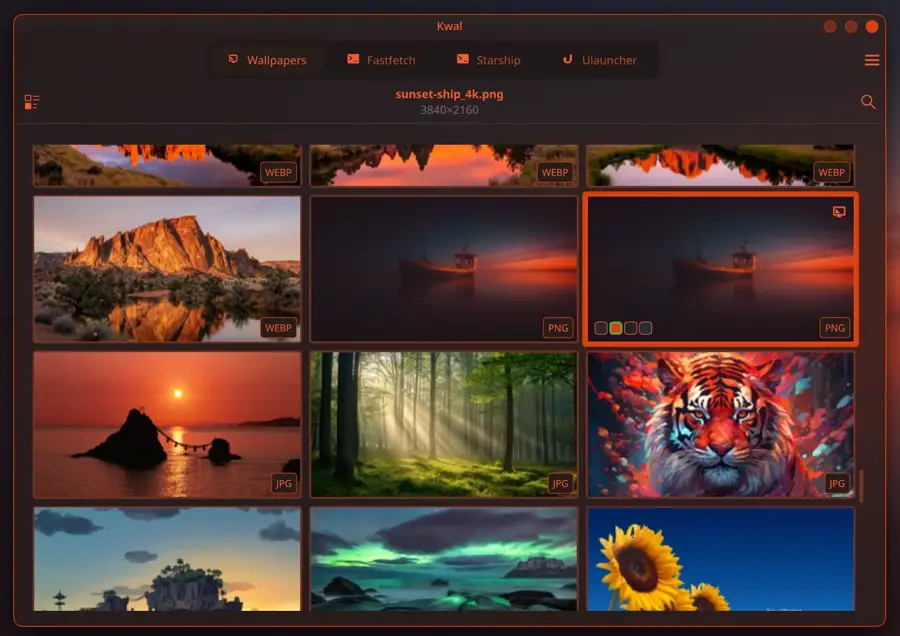

<p align="center">
  
</p>

# Kwal

KDE Plasma utility to manage the desktop wallpaper and to tint supported tools
with color palettes extracted from the wallpaper.

<p align="center">
  
</p>

## Features

- **Wallpapers**: browse folders, thumbnail grid, images and videos (with
  inline preview), search by name/tags and by 15 color categories.
- **Palettes**: Material You color schemes plus ImageMagick accent and unique
  colors, per wallpaper, in light and dark.
- **Custom commands**: shell commands run after a wallpaper is applied, with
  placeholders (`%path%`, `%image%`, `%scolor%`, `%mode%`, `%ccolor%`, …).
- **Tool tinting**: Fastfetch, Starship and Ulauncher tabs (each appears only
  when its binary is on `PATH`) recolor those tools with the extracted palette
  and preview the result.
- **Wallpaper transitions**: an animated switch over a Wayland layer-shell
  overlay; falls back to a plain switch when unavailable.
- **AI tagging**: optional OpenAI-compatible vision endpoint to tag wallpapers.

## Requirements

- CMake ≥ 3.16 + Ninja, GCC with C++20
- ECM / KDE Frameworks 6.31 (`Config`, `Kirigami`, `KirigamiPlatform`)
- Qt 6 (≥ 6.8): `Core`, `Gui`, `Multimedia`, `Network`, `Qml`, `Quick`,
  `QuickControls2`, `Widgets`, `WebEngineQuick`
- ffmpeg (`libavutil` dev package; Qt Multimedia's FFmpeg backend)
- ImageMagick (`magick`) at runtime
- Wayland for the transition overlay: `wayland` (libwayland-client +
  `wayland-scanner`) and `wayland-protocols` ≥ 1.24

CMake fetches `tomlplusplus` and `material-color-utilities` with `FetchContent`.
For an offline or packaged build, point `FETCHCONTENT_SOURCE_DIR_TOMLPLUSPLUS`
and `FETCHCONTENT_SOURCE_DIR_MCU` at prepared source trees and configure with
`-DFETCHCONTENT_FULLY_DISCONNECTED=ON`.

## Installation

Clone the tag you want and check its signature:

```sh
git clone --branch v0.1.0 https://github.com/iguruspain/kwal.git
cd kwal
git -c gpg.ssh.allowedSignersFile=docs/kwal_signers verify-tag v0.1.0
```

Release tags are signed with the SSH key published in `docs/kwal_signers`, so
that command prints `Good "git" signature for …`.

### Option A — Arch Linux

```sh
cd packaging/aur
makepkg -si
```

*(Installs `kwal` and `kwal-transition`, the desktop entry and the icon through
pacman; remove with `sudo pacman -Rns kwal`.)*

### Option B — any distro

```sh
cmake --preset default          # Ninja, Debug, compile_commands.json
cmake --build --preset default
ctest --test-dir build          # unit tests
cmake --install build           # add --prefix ~/.local for a per-user install
```

A manual install copies four files, and removing them uninstalls it:

```sh
PREFIX=~/.local   # /usr if you installed without --prefix
rm -f "$PREFIX"/bin/kwal "$PREFIX"/bin/kwal-transition \
      "$PREFIX"/share/applications/org.kde.kwal.desktop \
      "$PREFIX"/share/icons/hicolor/scalable/apps/kwal.svg
```

## Configuration

Settings live in `~/.config/kwalrc`, the tool templates in
`~/.config/kwal/templates` and the media caches (thumbnails, video frames and
resizes) in `~/.cache/kwal/`. Removing the app leaves those alone; delete them
for a clean slate.

## Acknowledgements

- [awww](https://codeberg.org/LGFae/awww) — the animated wallpaper switch of
  `kwal-transition` is a C++ port of its transition renderer (via the
  awww-based `kdewall-plugin-switcher` reference implementation).
- [Smart Video Wallpaper Reborn](https://github.com/luisbocanegra/plasma-smart-video-wallpaper-reborn)
  by [luisbocanegra](https://github.com/luisbocanegra) — the Plasma 6 wallpaper
  plugin kwal drives to play video wallpapers (desktop and lockscreen),
  including the video playlists it maintains in the plugin's config.

## License

GPL-3.0-or-later — see `LICENSE.txt`.
